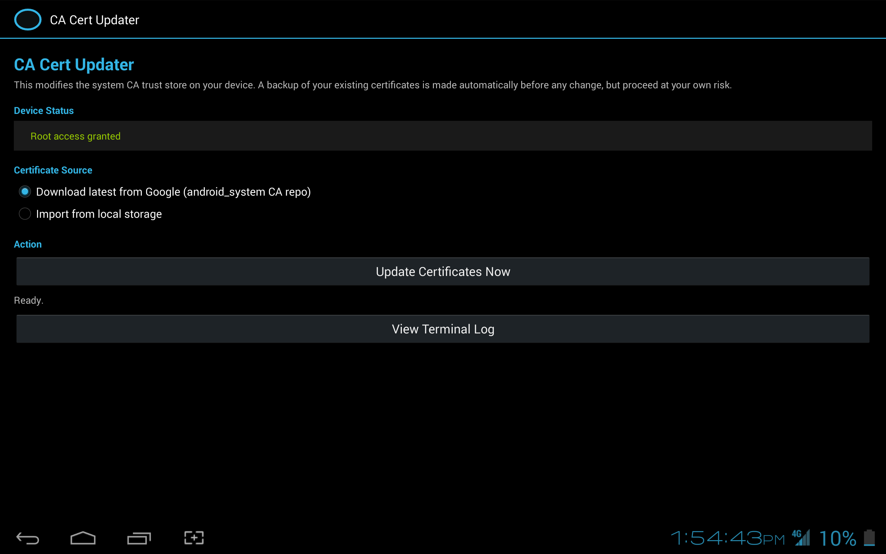
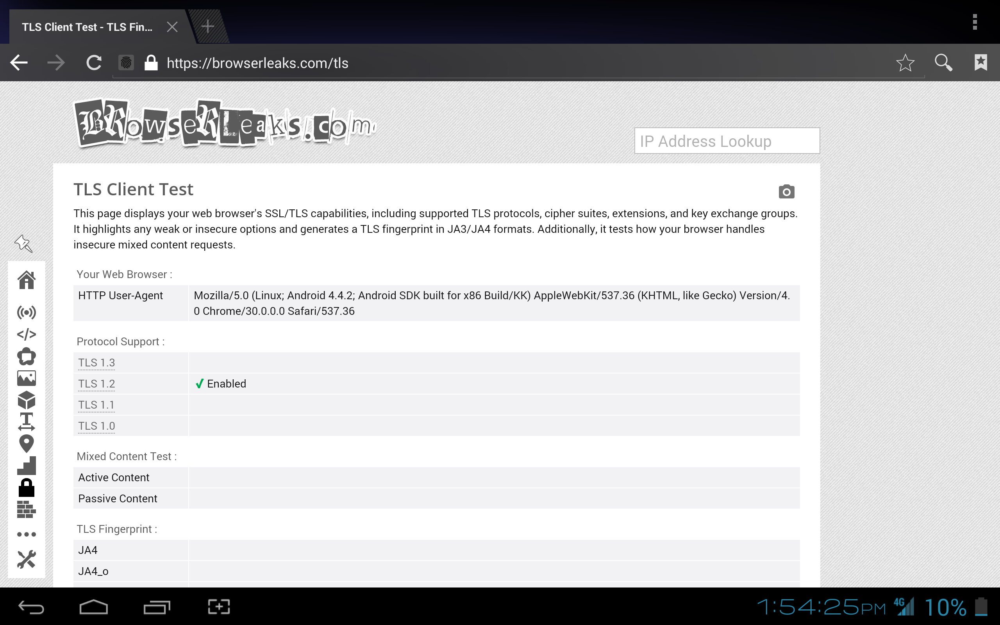

# CA Cert Updater

A small, native Holo-themed Android app that automates the manual
"update the system CA trust store" process that shows up in
`r/androidafterlife` guides for keeping very old Android devices able to
reach modern HTTPS sites. It does, with a tap, what the manual tutorial
does over `adb`:

```
mount -o rw,remount,rw /system
cp <new cert files> /system/etc/security/cacerts/
chmod / chown the new files
mount -o ro,remount,ro /system
reboot
```

**Requires a rooted device.** It will not work, and will tell you so
plainly, on a non-rooted device. `minSdkVersion` is 14 (Android 4.0 ICS).

## What it does

1. Checks for root (`su`) on launch.
2. Lets you choose a certificate source:
   - **Download automatically** — pulls the current CA bundle straight
     from Google's public `android_system/ca-certificates` source
     archive.
   - **Import from local storage** — pick a `.tar.gz`/`.tgz`, `.zip`, or a
     single `.pem`/`.crt`/`.cer`/`.der` file yourself (useful on devices
     whose browser/TLS stack is too outdated to reach the download URL —
     exactly the chicken-and-egg problem this app exists to fix).
3. Extracts the certificate files itself (hand-rolled tar/zip readers —
   no external libraries, no `tar` binary required on the device).
4. Runs the actual install as a single root shell session: backs up your
   existing certs to a timestamped folder under `/system/etc/security/`
   first, then copies in the new ones, fixes permissions/ownership, and
   remounts `/system` read-only again.
5. Shows a live terminal-style log of every command and its output
   (tap "View Terminal Log").
6. Offers a one-tap reboot once the install finishes.

## Screenshots

<p align="center">
  
  
</p>

## Project layout

```
CertUpdater/
├── app/
│   ├── build.gradle
│   └── src/main/
│       ├── AndroidManifest.xml
│       ├── java/com/androidafterlife/certupdater/
│       │   ├── MainActivity.java       UI + orchestration
│       │   ├── LogActivity.java        terminal-style output viewer
│       │   ├── LogStore.java           shared in-memory log buffer
│       │   ├── RootUtils.java          su detection + command execution
│       │   ├── CertDownloader.java     HTTP download of the cert bundle
│       │   ├── ArchiveExtractor.java   tar.gz / zip / single-cert import
│       │   └── CertInstaller.java      builds & runs the install script
│       └── res/
│           ├── layout/                 activity_main.xml, activity_log.xml
│           ├── values/                 styles.xml (Theme.Holo), strings, colors
│           └── drawable/               ic_launcher.xml
├── build.gradle
├── settings.gradle
└── gradle.properties
```

No AndroidX, no support library, no third-party dependencies at all —
just the plain Android framework SDK. That's deliberate: it's what lets
`android:Theme.Holo` render as the real, native holographic theme instead
of being overridden by AppCompat/Material, and it keeps the app buildable
all the way down to API 14 without any library-version conflicts.

## Building it

You'll need [Android Studio](https://developer.android.com/studio) (or
just the command-line SDK tools + a JDK).

**Easiest path — Android Studio:**
1. `File → Open`, select the `CertUpdater` folder.
2. Let it sync (it will fetch the Gradle wrapper and Android SDK
   platform 28 automatically on first sync if you don't already have
   them).
3. `Build → Build Bundle(s)/APK(s) → Build APK(s)`, or just hit Run with
   a device/emulator connected.

**Command line**, if you already have the Gradle wrapper jar and an
Android SDK installed and `ANDROID_HOME` set:
```
cd CertUpdater
gradle wrapper --gradle-version 7.6.4   # only needed once, to generate gradlew/gradlew.bat
./gradlew assembleDebug
```
The APK lands in `app/build/outputs/apk/debug/app-debug.apk`.

(I built this project's source and resources for you in this sandbox,
but couldn't compile the final APK myself — this environment has no
Android SDK and no network access. The steps above are the standard way
to turn this source into an installable APK.)

## Testing on the device

1. Install the APK, grant your root manager (Magisk/SuperSU/etc.) the
   prompt it will show on first launch.
2. Choose "Download automatically" first; if that fails (old TLS stack
   can't reach the URL), fall back to "Import from local storage" —
   download `files.tar.gz` yourself from
   `https://android.googlesource.com/platform/system/ca-certificates/+archive/refs/heads/main/files.tar.gz`
   on a modern computer/phone and copy it onto the device.
3. Tap **Update Certificates Now**, watch the status line (or the full
   terminal log), then **Reboot Device** once it reports success.

## Safety notes

- A full backup of the existing `/system/etc/security/cacerts/` directory
  is made automatically, to a sibling `..._backup_<timestamp>` folder,
  before anything is overwritten. If something looks wrong after reboot,
  you can restore it manually the same way (remount rw, copy back, remount
  ro) using any root file manager or terminal app.
- Modifying `/system` on an unsupported/aging device always carries some
  risk. Make sure you have a way to recover the device (TWRP/custom
  recovery backup, etc.) before doing this on anything you can't easily
  re-flash.
- The app never disables SELinux, never requests broad "device admin"
  powers, and only ever talks to `android.googlesource.com` over HTTPS
  for the optional auto-download.
